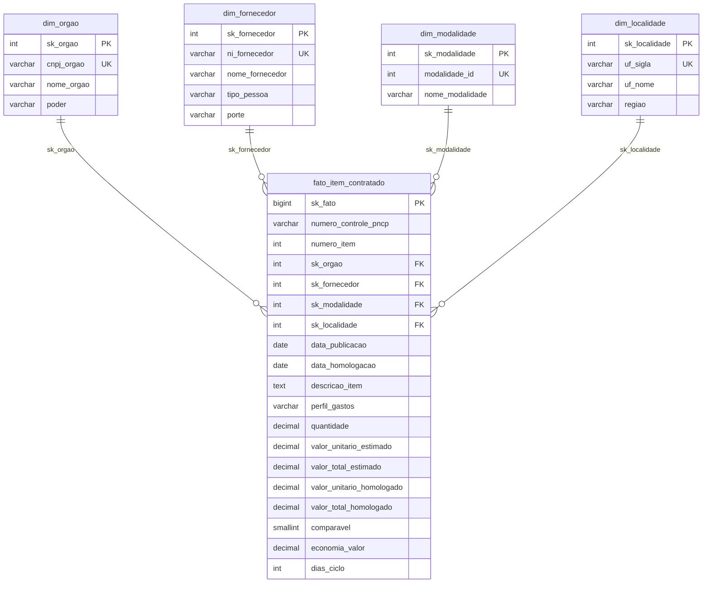
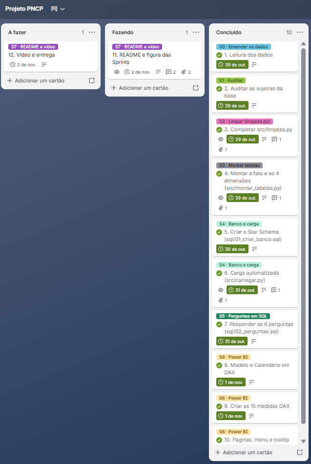

# Radar de Compras Públicas — PNCP 2025

Esteira ponta a ponta: **PNCP (CSV bruto) → Python (auditoria e limpeza) → PostgreSQL (Star Schema) → Power BI (dashboard executivo)**.

## 1. Contexto do problema
A Controladoria suspeita de sobrepreço, concentração de contratos em poucos fornecedores, demora entre edital e homologação e baixa competição em certas modalidades. Os dados dos sistemas legados (compras federais publicadas no PNCP em 2025: 2.042 contratações, 7.077 itens, 15.896 resultados) vêm com identificadores, valores e datas corrompidos, então ninguém confia nos relatórios. O projeto limpa a base, a organiza em um modelo dimensional e responde 6 perguntas:

| # | Pergunta | Onde responde |
|---|---|---|
| 1 | Quanto o governo economizou (R$ e %)? | `sql/02_perguntas.sql` e dashboard |
| 2 | Quem são os maiores fornecedores e quanto concentram? | idem |
| 3 | Quais modalidades economizam mais e movimentam mais dinheiro? | idem |
| 4 | Qual o ciclo médio edital → homologação por órgão? | idem |
| 5 | Quais estados/regiões gastam mais e têm mais desconto? | idem |
| 6 | Como o gasto se divide entre bens, serviços e obras? | idem |

## 2. Decisões técnicas e por quê
- **Tudo lido como texto (`dtype=str`)**: evita o pandas perder o zero à esquerda do CNPJ e converter valores errado antes da limpeza.
- **Funções de limpeza pequenas e testadas** (`src/limpeza.py`, com 54 exemplos no autoteste): cada problema tem uma função, o que facilita explicar e testar.
- **Um vencedor por item**: primeiro descarta os resultados cancelados, depois pega o menor `ordem_classificacao_srp` (vazio = 1), desempatando pelo menor `sequencial_resultado`. Se fizesse ao contrário, itens cujo 1º colocado foi cancelado ficariam sem vencedor.
- **Só itens com resultado entram na fato** (852 itens sem resultado ficam de fora) e **99 itens são rejeitados** por dados impossíveis: quantidade ou valor unitário ≤ 0 ou ausente, orçamento sigiloso, total estimado < R$ 1, homologado > 1.000× o estimado, ou valor acima de R$ 1 trilhão.
- **Economia só nos itens comparáveis** (não é Credenciamento e homologado/estimado entre 0,1 e 10). Percentual = soma ÷ soma, nunca média de percentuais.
- **Separador numérico**: ponto ou vírgula sozinho é decimal (`0,754`, `746.815`); só o símbolo repetido é milhar. Do contrário o volume viraria R$ 31 bi em vez de R$ 8 bi.
- **Cronologia**: homologação anterior à publicação é impossível, então a data e o ciclo ficam vazios, mas o item permanece na fato.
- **Perfil do gasto**: palavras `obra, construção, reforma, engenharia` (com `\b`, palavra inteira) têm prioridade e viram "Obras e engenharia"; o resto usa `material_ou_servico` (Bens/Serviços).
- **Star Schema com chaves substitutas** (`sk_`): a análise precisa de uma fato com os números e dimensões por quem/como/onde. As chaves naturais ficam como `UNIQUE`, a fato tem `CHECK` (quantidade > 0, valores ≥ 0) e as dimensões têm a linha de exceção "Não informado" (`sk = -1`). O banco é a segunda barreira de qualidade.
- **Carga em lote** (`execute_values`) com validação prévia de FK solta, `rollback` em caso de erro e conferência de contagens ao final.
- **Calendário** criado em DAX (hora/data automática desligada) e **tooltip** de página para detalhar indicadores sem poluir.

## 3. Dicionário das inconsistências tratadas
Contagens obtidas na auditoria dos CSVs brutos.

| Problema | Onde / quanto | Tratamento |
|---|---|---|
| CNPJ com máscara e zero perdido | `cnpj_orgao`: 307 com máscara, 77 com menos de 14 dígitos. `ni_fornecedor` PJ: 1.934 com máscara, 194 com menos de 14 dígitos (de 11.344) | `limpar_documento`: só dígitos + `zfill` (14 PJ, 11 PF); estrangeiro (PE) mantido |
| Dinheiro em texto | `R$` e espaço em 1.188 valores estimados e 2.650 homologados; milhar/decimal invertidos (`1.234,56` e `1,234.56`) | `converter_numero`: remove `R$`, decide o decimal pelo último símbolo, negativo por `(...)` ou `-` |
| Datas em 7 formatos | `data_publicacao`: ISO com hora (1.319), `dd-mm-aaaa`, `dd/mm/aaaa hh:mm`, `dd.mm.aaaa`, `dd/mm/aaaa`, `aaaa/mm/dd`, `aaaammdd`. `data_resultado` idem | `converter_data`: corta a hora, tenta cada formato, aceita só anos 2000–2030 |
| Homologação antes da publicação | 234 resultados (230 itens na fato) | Data de homologação e ciclo viram `NULL` |
| Nulos disfarçados | `porte` com 4.893 valores `N/A`, `-`, `0`, "Sem informação" etc. | `eh_nulo`/`limpar_texto` devolvem `None`; o `0` só é nulo em texto, nunca em número |
| Acento quebrado (Latin-1/UTF-8) | `objeto_compra`: 173, `descricao`: 223, `nome_fornecedor`: 4 | `consertar_acento` |
| Espaços invisíveis e repetidos | 53 razões sociais, 196 descrições, 424 nomes de fornecedor | `remover_invisiveis` + `tirar_espacos` |
| Nomes de órgão diferentes | 440 grafias para 352 nomes padronizados | `padronizar_nome` (maiúsculas, hífen com espaços) |
| Resultados cancelados e SRP | 62 cancelados; 3.920 resultados com ordem de classificação | Descarta cancelados e escolhe 1 vencedor por item |
| Orçamento sigiloso | 54 itens | Rejeitados (não vão para a fato) |
| Região ausente | `uf_sigla` sem região | Dicionário UF → região em `montar_tabelas.py` |

## 4. Diagrama da modelagem dimensional

`numero_controle_pncp + numero_item` é `UNIQUE` (grão da fato). O Calendário existe só no Power BI (DAX) e se relaciona com `data_publicacao` (ativa) e `data_homologacao` (inativa).

## 5. Técnicas e tecnologias
Python 3.10+ (pandas, psycopg2) · PostgreSQL 16 · SQL (DDL, agregações, subconsultas) · Power BI Desktop (DAX, bookmarks, tooltip de página) · Trello (Sprints) · Git/GitHub · Modelagem dimensional (Star Schema, chaves substitutas) · princípios CRAP de design.

## 6. Como reproduzir do zero
Pré-requisitos: Python 3.10+, PostgreSQL em execução e Power BI Desktop.
```bash
git clone https://github.com/jsidegum/projeto_pncp && cd projeto_pncp
python -m venv .venv 
.venv\Scripts\activate
pip install -r requirements.txt
cp .env.example .env           # edite a senha do PostgreSQL
python -m src.limpeza          # autoteste: deve mostrar 54 de 54 certos
python -m src.montar_tabelas   # gera data/processed/*.csv e imprime a conferência
python -m src.carregar         # recria o banco, cria as tabelas (sql/01) e carrega
```

Depois rode `sql/02_perguntas.sql` no pgAdmin e abra `powerbi/PNCP_Dashboard_2025.pbix` (conector PostgreSQL → `localhost` / `pncp_controladoria`).

Números esperados (e obtidos): 6.126 itens · 99 rejeitados · 2.652 fornecedores · 363 órgãos · volume R$ 8.044.498.805,74 · economia 14,46% (R$ 992.861.686,95) · Top 10 fornecedores = 41,43% do volume · ciclo médio 48,1 dias (máx. 611) · 230 itens sem ciclo.

## 7. Estrutura do repositório

```text

├── data/
│   ├── raw/            # CSVs brutos fornecidos (entrada)
│   └── processed/      # Tabelas limpas geradas pelo pipeline (ignorado no Git)
├── src/
│   ├── config.py       # Configurações de caminhos e ambiente (.env)
│   ├── banco.py        # Conexão, DDL, consultas e carga em lote
│   ├── limpeza.py      # Funções de higienização de dados e autoteste
│   ├── montar_tabelas.py # Regras de negócio da fato e 4 dimensões
│   └── carregar.py     # Script de ingestão automatizada no PostgreSQL
├── sql/
│   ├── 01_criar_banco.sql  # DDL do Star Schema (tabelas, constraints, chaves)
│   └── 02_perguntas.sql    # Consultas SQL das 6 perguntas da Controladoria
├── powerbi/
│   └── PNCP_Dashboard_2025.pbix # Dashboard executivo (Power BI + DAX)
├── docs/
│   ├── img/sprints.png # Figura oficial do planejamento em Sprints
├── requirements.txt    # Dependências do projeto Python
└── .env.example        # Modelo de variáveis de ambiente
```


## 8. Planejamento em Sprints (Trello)

> 📋 **Gestão de Projeto:** Para conferir o detalhamento de cada cartão, prazos e evolução metodológica, acesse o [Quadro de Sprints no Trello](https://trello.com/b/EeSvqydL/projeto-pncp).



## 9. Melhorias futuras
- Orquestrar a esteira com um único comando (ou Airflow) e consumir a API do PNCP direto, de forma incremental.
- Agrupar órgãos por código oficial (SIAFI/SIORG), em vez de nome padronizado.
- Detectar sobrepreço por item (preço homologado vs. mediana do mesmo item) e usar o catálogo oficial de itens.
- Separar serviços continuados de eventuais e refinar o perfil de gasto com mais palavras-chave.
- Agendar a atualização do dashboard e adicionar testes de qualidade de dados na carga.
